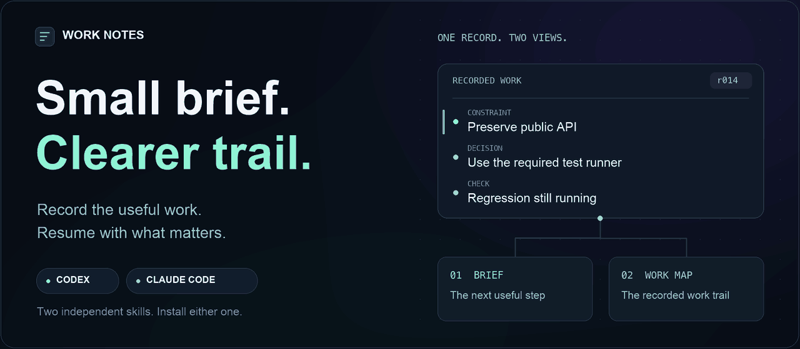

<picture>
  <source media="(prefers-reduced-motion: reduce)" srcset="docs/assets/work-notes-poster.png">
  
</picture>

<h1 align="center">Work Notes</h1>

<p align="center">
  <strong>A continuation brief for your agent. A work map for you.</strong><br>
  Decisions, attempts, checks, and corrections — kept useful beyond the current conversation.
</p>

<p align="center">
  <a href="https://github.com/Abhishekpundir23/agent-work-notes/actions/workflows/tests.yml"></a>
  
  
  
</p>

<p align="center">
  <a href="#install"><strong>Install</strong></a> &nbsp; · &nbsp;
  <a href="#two-views-one-record">See the outputs</a> &nbsp; · &nbsp;
  <a href="#try-the-cli">Try the CLI</a> &nbsp; · &nbsp;
  <a href="#design-and-research">Design &amp; research</a> &nbsp; · &nbsp;
  <a href="docs/assets/work-notes-poster.png">Static artwork</a>
</p>

---

Agent work leaves more than a final answer: a constraint to preserve, an approach that failed, a check still running, a decision someone corrected. **Work Notes gives those records a place to live and a compact way back into the task.**

Choose the Codex skill or the Claude Code skill. Each runs independently, with its own local state and host adapter. The scripts use Python's standard library and make no model API, embedding, or network calls.

## Two views, one record

| **01 / Continuation brief** | **02 / Human work map** |
| :--- | :--- |
| Current task state in a bounded reading budget. | Recorded work, stated reasons, evidence, and relationships. |
| Constraints, active decisions, unresolved checks, and the next useful step. Overflow points to exact records. | Attempts and corrections remain visible. Follow dependencies and inspect how the recorded decisions changed. |
| [Read the example brief →](examples/retry-brief.md) | [Explore the example map →](examples/retry-map.md) |

Both views are generated from **the same event revision**. The examples use synthetic fixtures; the artwork above illustrates the workflow, not a product UI. The map captures observed work and stated rationale, not private internal reasoning.

### What stays visible

| When work gets complicated… | Work Notes keeps track of… |
| :--- | :--- |
| A decision changes | The correction, earlier records, and dependent guidance that is now stale. |
| A test starts but never finishes | Its `running` or `unknown` state, separate from `passed`. |
| The brief reaches its limit | An explicit overflow route to retrieve the omitted records. |
| Two corrections disagree | The unresolved conflict, instead of silently choosing one. |
| Evidence or capture is missing | The gap, alongside the records that are available. |

## Install

**Prerequisite:** Python 3.10+. Choose one complete skill folder, including its `scripts/` and `references/` directories.

| | **Codex** | **Claude Code** |
| :--- | :--- | :--- |
| Package | [`codex-work-notes`](skills/codex-work-notes) | [`claude-work-notes`](skills/claude-work-notes) |
| Personal location | `~/.agents/skills/codex-work-notes/` | `~/.claude/skills/claude-work-notes/` |
| Project location | `.agents/skills/codex-work-notes/` | `.claude/skills/claude-work-notes/` |
| Invoke | `$codex-work-notes` | `/claude-work-notes` |
| Host guide | [Codex skills](https://learn.chatgpt.com/docs/build-skills) | [Claude Code skills](https://code.claude.com/docs/en/skills) |

<details>
<summary><strong>Copy-and-paste setup · personal installation</strong></summary>

Clone the repository, then run **one** of the installation blocks below:

```sh
git clone https://github.com/Abhishekpundir23/agent-work-notes.git
cd agent-work-notes
```

**Codex**

```sh
mkdir -p "$HOME/.agents/skills"
if [ ! -e "$HOME/.agents/skills/codex-work-notes" ] && [ ! -L "$HOME/.agents/skills/codex-work-notes" ]; then
  cp -R skills/codex-work-notes "$HOME/.agents/skills/codex-work-notes"
else
  echo 'An installation already exists. Inspect it before updating.'
fi
```

**Claude Code**

```sh
mkdir -p "$HOME/.claude/skills"
if [ ! -e "$HOME/.claude/skills/claude-work-notes" ] && [ ! -L "$HOME/.claude/skills/claude-work-notes" ]; then
  cp -R skills/claude-work-notes "$HOME/.claude/skills/claude-work-notes"
else
  echo 'An installation already exists. Inspect it before updating.'
fi
```

For a project installation, copy the chosen folder into the project location listed above. Reload skill discovery or restart your host if the new skill is not listed.

</details>

Copying a skill enables the notes workflow. **Automatic hook capture is a separate, optional setup**; see [capture and storage](#capture-and-storage).

## Try the CLI

From this cloned repository, choose an existing project and a task ID:

```sh
NOTES="$PWD/skills/codex-work-notes/scripts/notes.py"
PROJECT=/absolute/path/to/your/project
TASK=retry-timeouts

# Start a task and record a meaningful constraint.
python3 "$NOTES" --root "$PROJECT" --task "$TASK" init \
  --objective 'Fix retry timeouts'
python3 "$NOTES" --root "$PROJECT" --task "$TASK" add \
  --kind constraint --actor user --text 'Preserve the public API' \
  --source 'User request'

# Keep the actual check state visible.
python3 "$NOTES" --root "$PROJECT" --task "$TASK" add \
  --kind check --status running --text 'Targeted regression is still running'

# Read a bounded brief, then write both views from the same revision.
python3 "$NOTES" --root "$PROJECT" --task "$TASK" brief --max-bytes 6000
python3 "$NOTES" --root "$PROJECT" --task "$TASK" render --max-bytes 6000
```

For Claude Code, use `skills/claude-work-notes/scripts/notes.py` as `NOTES`. Replace the example statements with what actually happened. Explicit `--root` and `--task` keep project and task selection deliberate.

<details>
<summary><strong>Keep notes efficient · checkpoints, overflow, and retrieval</strong></summary>

Use a short objective and separate constraints. Record meaningful changes at checkpoints with `batch --file events.json`; avoid repeating unchanged observations.

The brief's limit applies to its **complete UTF-8 byte size**, not an exact token count. If it reports overflow, recover applicable records before acting:

```sh
python3 "$NOTES" --root "$PROJECT" --task "$TASK" pending --offset 0 --limit 20
python3 "$NOTES" --root "$PROJECT" --task "$TASK" get ID [ID ...]
```

Follow the returned pagination offsets. Replace `ID [ID ...]` with record IDs; one `get` call accepts up to 100. If the task ID is unknown, inventory it with `python3 "$NOTES" --root "$PROJECT" tasks`.

Full command references: [Codex](skills/codex-work-notes/references/cli.md) · [Claude Code](skills/claude-work-notes/references/cli.md).

</details>

## Capture and storage

<details>
<summary><strong>Optional hooks · capture supported host activity</strong></summary>

```sh
python3 "$NOTES" --root "$PROJECT" --task "$TASK" hook-config
```

This **prints configuration**. Review it and merge its event groups into `.codex/hooks.json` for Codex or `.claude/settings.json` for Claude Code, retaining existing configuration. Commands bind an explicit task; choose the intended task before enabling capture. Codex also requires trust review for non-managed hooks.

Host coverage differs. Follow the separate [Codex capture guide](skills/codex-work-notes/references/capture.md) or [Claude Code capture guide](skills/claude-work-notes/references/capture.md). A settings file does not prove hooks ran: observe a native host trial before calling the installation verified.

</details>

<details>
<summary><strong>Local state · inspectable records and generated views</strong></summary>

```text
.work-notes/
└── <host>/
    ├── events.sqlite3
    └── views/<task>/
        ├── current.json
        └── r<revision>-b<max-bytes>/
```

The owned state directory has a local ignore file so ordinary Git staging excludes it. Review notes before explicitly exporting or sharing them. Rendering refuses to overwrite modified generated bytes; preserve and move the affected revision directory aside before regenerating.

Corrections retain earlier records. A model or tool record cannot supersede a user constraint, objective, or decision, but caller-supplied actor labels are **not authenticated identities**. A file hash proves matching bytes, not correctness or authorship. A `passed` record is only as reliable as its evidence.

`doctor` checks store and evidence conditions. It cannot prove complete capture, correct interpretation, or successful task completion. Notes do not authorize external actions.

</details>

## Design and research

**Experimental v0.1.** The scripts need no extra model service, but using a skill still consumes the host agent's context and tool budget. Lower total token cost, improved task outcomes, complete automatic capture, and global novelty have **not** been established. Native provider-backed skill and hook trials remain outstanding.

| Explore | What you will find |
| :--- | :--- |
| [Specification](docs/SPEC.md) | Record semantics, correction rules, and view guarantees. |
| [Research](docs/RESEARCH.md) | Existing approaches, observed gaps, and hypotheses to test. |
| [Validation](docs/VALIDATION.md) | Regression coverage, manual exercises, measurements, and limits. |
| [Implementation](docs/IMPLEMENTATION.md) | Package structure and build decisions. |

Research continues during active development. Improvements should follow reproduced failures and measured hypotheses. A distribution license has not been selected.

<details>
<summary><strong>Develop locally · build, test, and package</strong></summary>

```sh
python3 tools/build.py --check
python3 -m unittest discover -s tests -v
python3 tools/build.py --zip
```

Edit canonical scripts in `src/`, then run `python3 tools/build.py` to refresh both independent packages. Archives appear in `dist/`. Optional local timing: `python3 tools/benchmark.py --events 5000 --runs 3`.

The README animation and static poster are generated locally by [`tools/render_readme.py`](tools/render_readme.py). Regenerating them requires Pillow; neither skill requires it. See [artwork notes](docs/assets/README.md).

</details>
