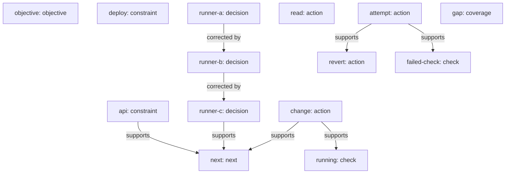

# Work map: retry-example

Host: codex. Source revision: 14. Capture: partial.
These records describe observed work and stated rationale, not private internal reasoning. Actor labels are caller-supplied. A matching file hash proves byte equality only.

## Current records

- [objective] objective · asserted: Fix retry timeout behavior
- [api] constraint · asserted: Preserve the public API and legacy zero-retry behavior.
- [deploy] constraint · asserted: Deploy only after explicit user approval.
- [runner-c] decision · asserted: Use Vitest, as required by the repository.
- [read] action · observed: Read src/core.py; left it unchanged.
- [attempt] action · attempted: Tried a timeout adjustment in src/retry.py.
- [failed-check] check · failed: Targeted check exited 1: expected 50 ms, got 500 ms.
- [revert] action · reverted: Restored the original src/retry.py after the unsuccessful experiment.
- [change] action · observed: Changed src/backoff.py to address the timing path; correctness still needs confirmation.
- [running] check · running: Regression command is still running; process token p7 has no final result.
- [gap] coverage · failed: Git capture failed with permission denied. Final diff is unavailable.
- [next] next · asserted: Collect p7 completion, restore diff visibility, and verify API and zero-retry behavior before reporting completion.

## Work history

### objective · objective · asserted · current

Fix retry timeout behavior

Actor: agent. Recorded: 2026-10-15T10:00:38.674+00:00. Source time: unavailable.

### api · constraint · asserted · current

Preserve the public API and legacy zero-retry behavior.

Actor: user. Recorded: 2026-10-15T10:00:38.674+00:00. Source time: unavailable.
Source: Synthetic user request

### deploy · constraint · asserted · current

Deploy only after explicit user approval.

Actor: user. Recorded: 2026-10-15T10:00:38.674+00:00. Source time: unavailable.
Source: Synthetic user request

### runner-a · decision · asserted · superseded

Use Jest.

Actor: agent. Recorded: 2026-10-15T10:00:38.674+00:00. Source time: unavailable.
Source: Initial assumption

### runner-b · decision · asserted · superseded

Use Mocha.

Actor: agent. Recorded: 2026-10-15T10:00:38.674+00:00. Source time: unavailable.
Source: Earlier correction
Supersedes: runner-a

### runner-c · decision · asserted · current

Use Vitest, as required by the repository.

Actor: user. Recorded: 2026-10-15T10:00:38.674+00:00. Source time: unavailable.
Source: Synthetic user correction
Supersedes: runner-b

### read · action · observed · current

Read src/core.py; left it unchanged.

Actor: agent. Recorded: 2026-10-15T10:00:38.674+00:00. Source time: unavailable.

### attempt · action · attempted · current

Tried a timeout adjustment in src/retry.py.

Actor: agent. Recorded: 2026-10-15T10:00:38.674+00:00. Source time: unavailable.

### failed-check · check · failed · current

Targeted check exited 1: expected 50 ms, got 500 ms.

Actor: agent. Recorded: 2026-10-15T10:00:38.674+00:00. Source time: unavailable.
Depends on: attempt

### revert · action · reverted · current

Restored the original src/retry.py after the unsuccessful experiment.

Actor: agent. Recorded: 2026-10-15T10:00:38.674+00:00. Source time: unavailable.
Depends on: attempt

### change · action · observed · current

Changed src/backoff.py to address the timing path; correctness still needs confirmation.

Actor: agent. Recorded: 2026-10-15T10:00:38.675+00:00. Source time: unavailable.

### running · check · running · current

Regression command is still running; process token p7 has no final result.

Actor: agent. Recorded: 2026-10-15T10:00:38.675+00:00. Source time: unavailable.
Depends on: change

### gap · coverage · failed · current

Git capture failed with permission denied. Final diff is unavailable.

Actor: agent. Recorded: 2026-10-15T10:00:38.675+00:00. Source time: unavailable.

### next · next · asserted · current

Collect p7 completion, restore diff visibility, and verify API and zero-retry behavior before reporting completion.

Actor: agent. Recorded: 2026-10-15T10:00:38.675+00:00. Source time: unavailable.
Depends on: api, change, runner-c

## Relationship map

